<div align="center">

# ENTRAIOT Labs

### The ESP32-S3 bench guide

**Learn IoT hands-on: a live pinout, guided labs, in-browser simulators, a friendly code reader and a datasheet made for makers.**

**Created by ENTRAIOT Labs**, a unit of **Entraiot Solutions**, Chennai, India

[](https://entralabs.vercel.app)
[](https://entraiot.com)


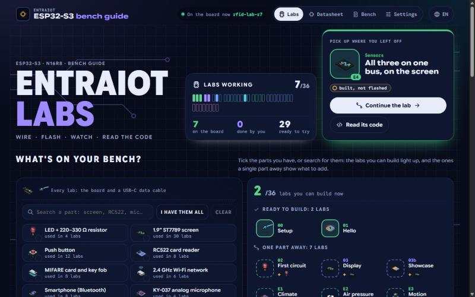

</div>

---

## Contents

- [Why ENTRAIOT Labs](#why-entraiot-labs)
- [Features](#features)
- [The labs](#the-labs)
- [What's new from ENTRAIOT Labs](#whats-new-from-entraiot-labs)
- [Bench log](#bench-log)
- [Architecture](#architecture)
  - [Tech stack](#tech-stack)
  - [System overview](#system-overview)
  - [Layers](#layers)
  - [A page load, end to end](#a-page-load-end-to-end)
  - [Widgets and simulators](#widgets-and-simulators)
  - [Code reader pipeline](#code-reader-pipeline)
  - [Datasheet pages](#datasheet-pages)
  - [Languages](#languages)
  - [Offline and caching](#offline-and-caching)
  - [Build and deploy pipeline](#build-and-deploy-pipeline)
- [Project structure](#project-structure)
- [Getting started](#getting-started)
- [Configuration](#configuration)
- [Design system](#design-system)
- [White-labelling](#white-labelling)
- [Deploy to Vercel](#deploy-to-vercel)
- [Quality checks](#quality-checks)
- [Team](#team)
- [License](#license)

---

## Why ENTRAIOT Labs

Most microcontroller tutorials are a wall of text and a wiring photo. ENTRAIOT Labs turns each project into **one interactive sheet**: what you will build, which pins it uses, how to wire it, the exact command to flash it, steps you can tick off, and a simulator showing what the board should do. Learners try everything in the browser first, then do it on the real board with confidence.

It is built for the **ESP32-S3 DevKitC-1 (N16R8)**, works on a phone, works offline, and needs no account.

---

## Features

| | Feature | What it does |
|---|---|---|
| 🌡️ | **Sensors labs** | New from ENTRAIOT Labs: temperature, humidity, pressure, altitude and tilt on one I2C bus, with sliders that stand in for the room. |
| 🧪 | **Browser simulators** | Every lab runs in the browser first. Type into the simulated serial monitor and the board replies the way the real firmware would. |
| 📖 | **Code reader** | Opens the actual firmware a lab flashes. **Tour** goes a few lines at a time with guess-first quizzes, **Story** follows the program from `setup()` through every call, **Explore** explains any line you tap. |
| 📑 | **Datasheet for makers** | The ESP32-S3 in plain terms: chip overview with a 3D dive to the die, every pin, all 32 peripheral blocks, memory, clocks and power modes, each fact citing Espressif's reference. |
| 🧩 | **Meet the board** | The DevKitC-1 in interactive 3D (Three.js) with callouts that light up each part and list the labs using it. |
| 📋 | **Bench log** | ENTRAIOT's own bench diary: what is on the board now and every build, check and flash, from plain JSON you can update without rebuilding. |
| ✅ | **Progress** | Ticks, last lesson and chosen variants are saved in the browser. No login. |
| 🔩 | **Parts library** | 42 isometric drawings of every component on the bench, coloured from design tokens. |
| 🌍 | **12 languages** | Including right-to-left Arabic and Persian. Share any page in a language with `?lang=fr`. |
| 📱 | **Phone ready** | Works at 390 px, light and dark themes, respects reduced motion. |
| 📴 | **Offline** | Installable PWA: lessons, code and data stay available without internet. |

<table>
  <tr>
    <td width="50%">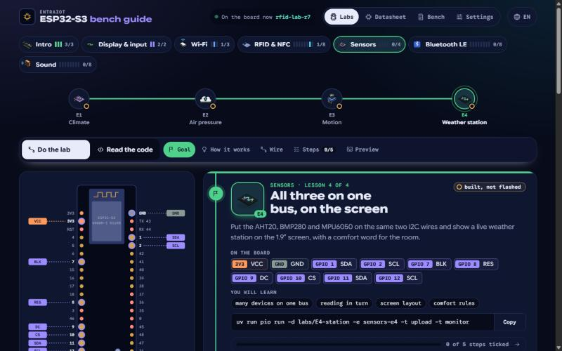</td>
    <td width="50%">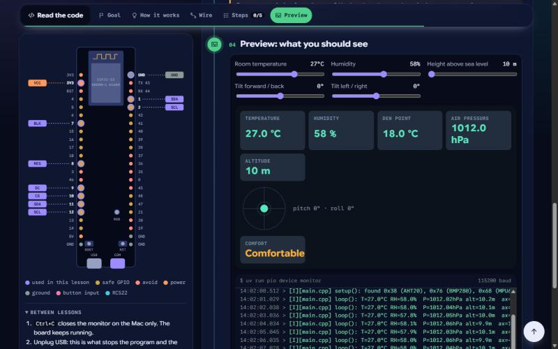</td>
  </tr>
  <tr>
    <td width="50%">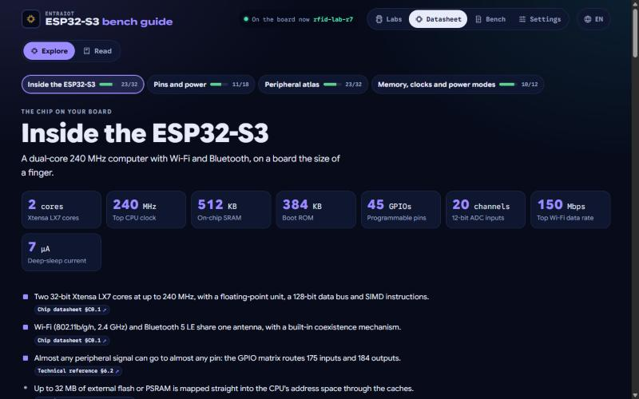</td>
    <td width="50%">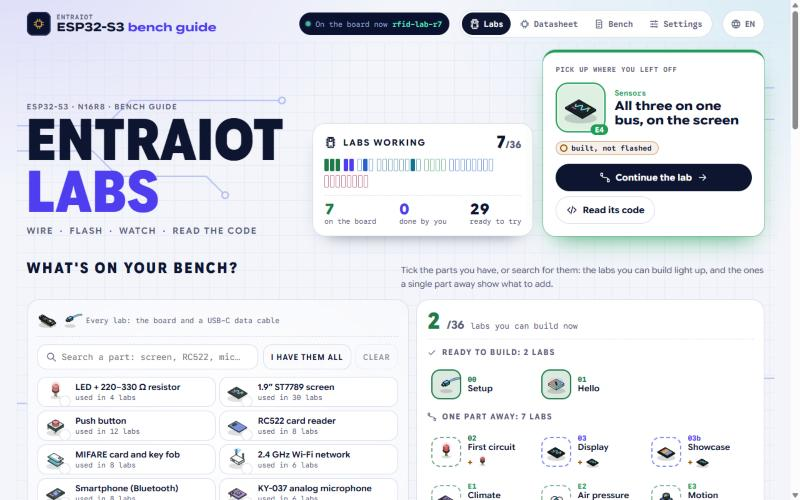</td>
  </tr>
</table>

<p align="center">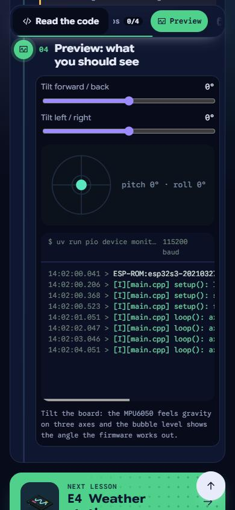</p>

---

## The labs

| Theme | Labs | What you build |
|---|---|---|
| **Intro** | 00 Setup · 01 Hello · 02 First circuit | The toolchain, a first program, an LED you control by command |
| **Display & input** | 03 Display · 03b Showcase | The 1.9″ TFT screen and the buttons |
| **Wi-Fi** | W1 Scan & join · W2 Phone control · W3 Internet & AI | Network scanning, a web page served by the board, HTTPS APIs |
| **RFID & NFC** | R1 → R8 | The 13.56 MHz field, card memory, a door lock with card admin, a kids' card game |
| **Bluetooth LE** | B1 → B8 | Advertising, pairing, a phone web app, a keyboard, music control |
| **Sound** | S1 → S8 | Loudness meter, clap control, recorder, spectrum, speaker, voice effects |
| **Sensors** | E1 Climate · E2 Air pressure · E3 Motion · E4 Weather station | AHT20, BMP280 and MPU6050 on one I2C bus, with live simulators *(new from ENTRAIOT Labs)* |

---

## What's new from ENTRAIOT Labs

| Area | Change |
|---|---|
| **Brand** | ENTRAIOT name across the header, home title, browser tabs and footer ("Created by ENTRAIOT Labs"), with all branding in one file for white-labelling |
| **Sensors track** | Four new labs, E1 to E4, with simulators and an I2C bus explainer (details below) |
| **Look** | New indigo-violet ENTRAIOT palette, navy dark mode, soft brand glow, raised cards and rounder corners |
| **Font** | Google Sans Flex for text and Google Sans Code for code, both open-source variable fonts |
| **Bench** | A fresh ENTRAIOT bench log and status, replacing the original diary |
| **Deploy** | Builds on Vercel straight from GitHub; the separate firmware repo is optional |

### Sensors track

All three sensors share one I2C bus: **SDA on GPIO 1, SCL on GPIO 2**, powered from **3V3**.

| Lab | Sensor | Address | What you build |
|---|---|---|---|
| **E1 Climate** | AHT20 | `0x38` | Temperature, humidity and dew point |
| **E2 Air pressure** | BMP280 | `0x76` | Pressure in hPa and altitude from the barometric formula |
| **E3 Motion** | MPU6050 | `0x68` | Pitch and roll from gravity, shown as a bubble level |
| **E4 Weather station** | All three + 1.9″ screen | — | A live station with a comfort word for the room |

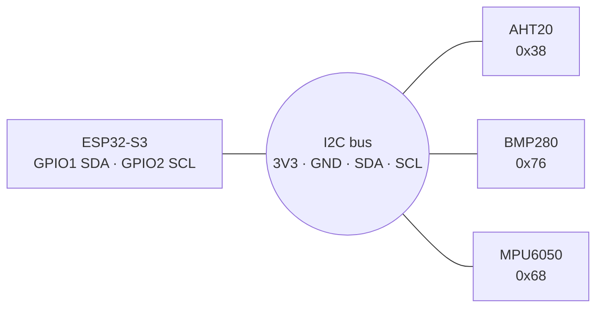

The sensor maths (raw bytes to °C, %, hPa, metres and degrees) lives in `src/labs/sensors/sensor-model.ts` as pure, unit-tested functions. The simulators are ready; the board firmware for E1 to E4 is the next step.

---

## Bench log

The **Bench** page is ENTRAIOT's own bench diary, read from two plain files in `public/data/`. No rebuild is needed to update them.

| File | What it holds |
|---|---|
| `bench-status.json` | "On the bench now": board, what is flashed, live site, team, and fact tables (sensor addresses, deployment) |
| `bench-log.json` | Every build, check and flash, numbered 1, 2, 3… with the command, why it ran, its output and the result |

Each log entry has this shape:

```json
{
  "n": 4,
  "types": ["flash"],
  "title": "Lab 01 Hello flashed",
  "where": "Laptop · board on USB",
  "cmd": "uv run pio run -d labs/01-hello -e 01-hello -t upload -t monitor",
  "why": "First program on the ENTRAIOT bench board.",
  "out": "…what the serial monitor printed…",
  "result": "Board shows its identity card and a rainbow LED."
}
```

`types` can be `install`, `build`, `read`, `reset`, `flash`, `failed` or `observe`. Numbers must run 1 to n with no gaps; a test checks it. Only record what really happened.

---

## Architecture

### Tech stack

| Concern | Choice | Why |
|---|---|---|
| UI | **React 19** + React Compiler | Automatic memoisation, no hand-written `useMemo` / `useCallback` |
| Build | **Vite 8** (Rolldown), `base: "./"` | One static bundle that runs on any host or subfolder |
| Routing | **React Router 8**, data mode, hash router | Loaders fetch content before render; hash URLs need no server rewrites |
| Data fetching | **TanStack Query 5** | Caching, de-duplication and retries for lessons, code and bench data |
| Languages | **i18next** + react-i18next | Typed keys, lazy loading per language, plurals, right-to-left |
| Validation | **zod 4** | Every setting and every fetched JSON file is checked on arrival |
| 3D | **Three.js** | Board model and chip scenes, loaded only when shown |
| Styles | CSS Modules + design tokens | Scoped styles, zero runtime cost, themes as token sets |
| Typography | **Google Sans Flex** + **Google Sans Code** | Google's open-source variable fonts, with weight, width and optical-size axes |
| Offline | vite-plugin-pwa (Workbox) | Precached app shell, lessons, code and data |
| Quality | TypeScript strict, ESLint, Vitest | Type safety, accessibility and hook rules, unit tests |
| Hosting | **Vercel** + Analytics + Speed Insights | Static deploy with security and cache headers |

### System overview

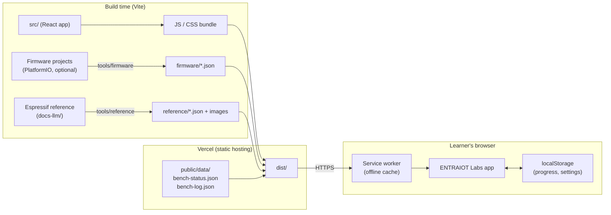

The whole product is a **static site**: no server, no database, no accounts. Everything a learner needs is produced at build time and served as files.

### Layers

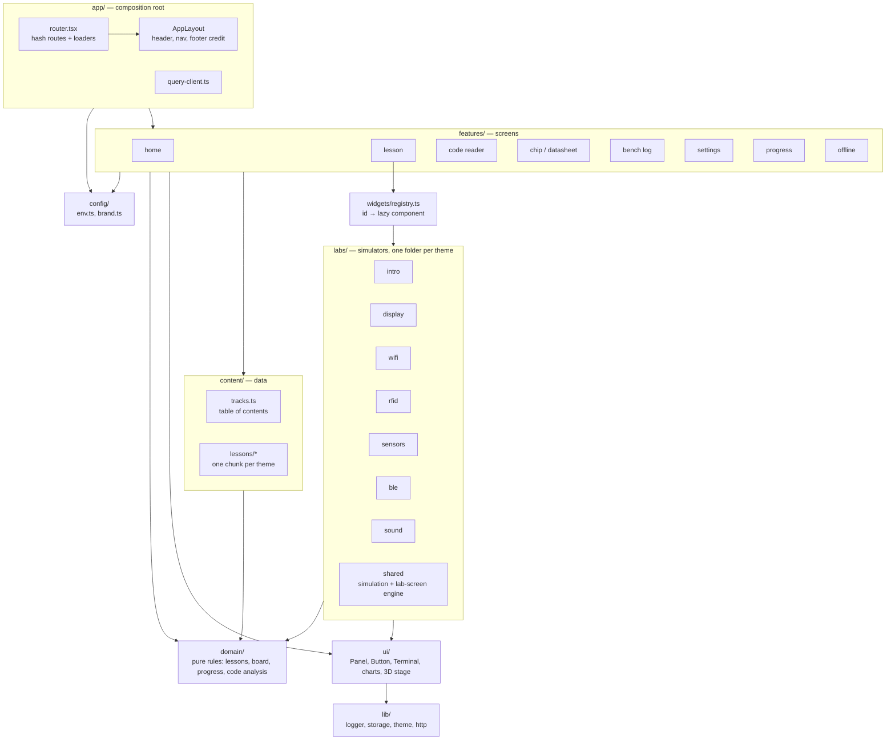

**Rule:** dependencies only point downward. `domain/` and `lib/` know nothing about screens, and one theme's simulators never import another theme's.

### A page load, end to end

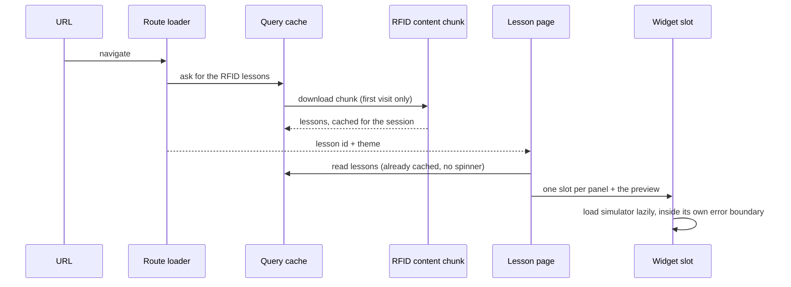

### Widgets and simulators

Every simulator, diagram and explainer follows one contract:

```ts
interface WidgetProps {
  lesson: ResolvedLesson;
  panel?: PanelSpec; // set when shown as a lesson panel, empty when it is the preview
}
```

- Each theme registers its widgets in `src/labs/<theme>/widgets.ts`, loaded **only when a lesson shows them**.
- Each widget sits inside `Suspense` and an `ErrorBoundary`: a broken simulator shows an error in its own panel and the rest of the lesson keeps working.

Simulators animate at 60 fps, so they follow three rules:

1. **Logic is plain TypeScript.** Firmware behaviour (command parsing, state machines, protocol maths) lives in pure, unit-tested `.ts` modules.
2. **Per-frame state is not React state.** It lives in a `Simulation` object read by a frame loop that pauses when off screen. React re-renders only on real changes.
3. **The frame loop only writes to elements React leaves empty**, so React and the animation never fight.

The RFID, BLE and sound previews share a **lab-screen engine**:

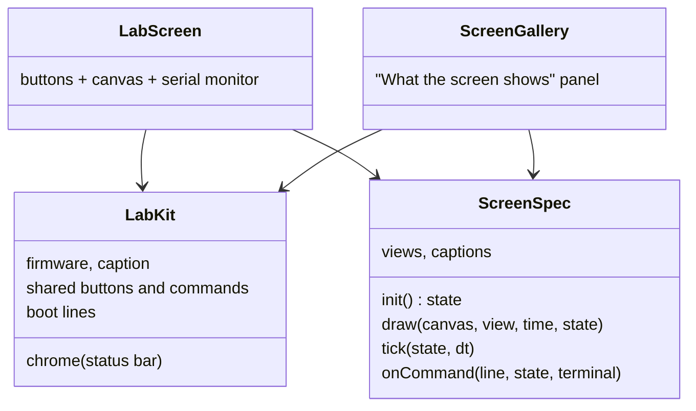

A theme writes one `LabKit` and one `ScreenSpec` per lab; `bindLab(kit, spec)` pairs them and the engine does the rest.

### Code reader pipeline

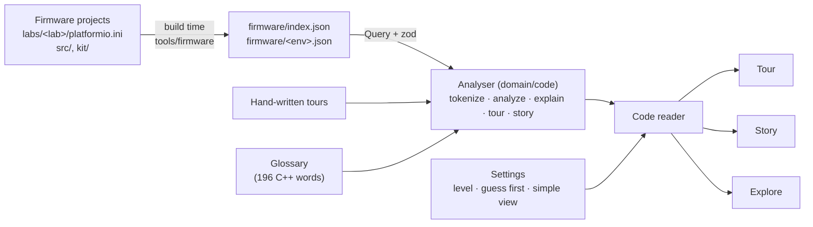

- The analyser is **pure TypeScript**: it splits C++ into tokens, finds chapters and blocks, writes a plain sentence for every line, and builds a call graph so **Story** can walk from `setup()` into every function.
- Three reading levels (Beginner, Explorer, Deep dive) and a **Simple view** keep it approachable.
- Firmware is optional at build time. Without it, the code reader is empty and every other part of the site works.

### Datasheet pages

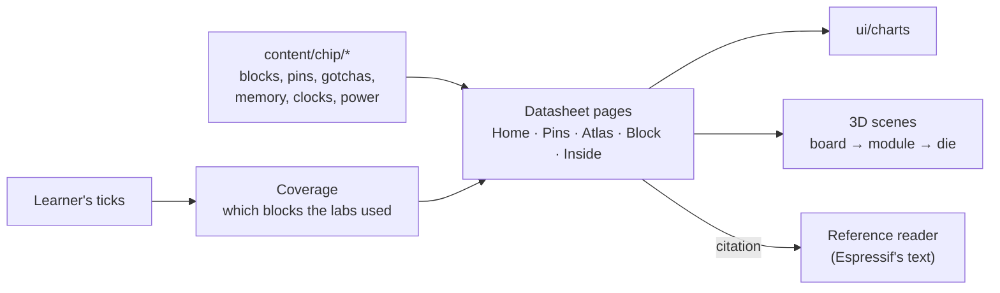

### Languages

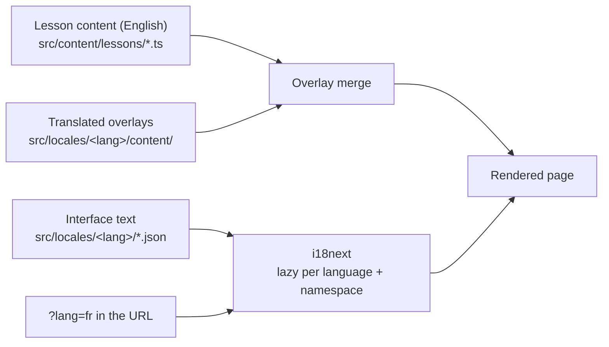

English, French, Spanish, Italian, German, Polish, Turkish, Chinese (Simplified and Traditional), Japanese, Arabic and Persian. Layouts use logical CSS, so right-to-left languages mirror correctly.

### Offline and caching

| What | How it is cached |
|---|---|
| App shell, JS, CSS | Precached by the service worker; `assets/` served as immutable for a year |
| Lessons, firmware JSON, bench data, reference text | Precached; re-validated on every deploy |
| Reference images, fonts | Cached the first time they are shown |
| Progress and settings | `localStorage` in the learner's browser |

A new deploy never reloads mid-lesson: the learner sees a **Reload** prompt instead.

### Build and deploy pipeline

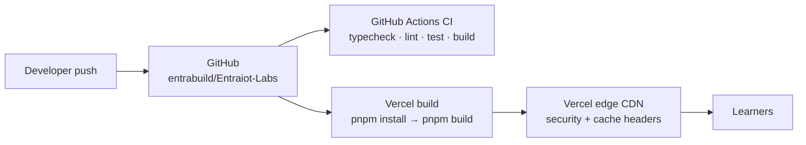

---

## Project structure

```text
Entraiot-Labs/
├── src/
│   ├── app/             # Router, layout (header, footer credit), route screens, error pages
│   ├── config/          # env.ts (build settings) · brand.ts (white-label settings)
│   ├── content/         # Table of contents, lessons per theme, chip facts, code tours, glossary
│   ├── domain/          # Pure logic: lessons, board pins, progress, C++ code analysis
│   ├── features/        # Screens: home, lesson, code reader, chip, bench, settings, offline…
│   ├── labs/            # Simulators, one folder per theme + shared engine
│   ├── widgets/         # Widget contract and lazy registry
│   ├── ui/              # Shared components: panels, terminal, charts, 3D stage, parts drawings
│   ├── lib/             # Logger, storage, theme, http helpers
│   ├── i18n/            # Language setup, overlays, catalogue checks
│   ├── locales/         # 12 languages: interface text + translated lesson content
│   └── styles/          # Design tokens and global styles
├── tools/
│   ├── firmware/        # Vite plugin: bundles firmware sources for the code reader
│   ├── reference/       # Vite plugin: turns Espressif's reference into reader documents
│   ├── chip/            # Checks every chip citation points to a real reference section
│   └── deploy/          # Release helpers
├── public/data/         # bench-status.json, bench-log.json (editable without rebuild)
├── docs/                # Architecture notes, i18n guide, media (GIFs)
├── docs-llm/            # Espressif ESP32-S3 reference (Markdown + figures)
├── vercel.json          # Vercel build, headers and caching
├── vite.config.ts       # Build, PWA and plugins
└── LICENSE · THIRD_PARTY_NOTICES.md · SECURITY.md
```

---

## Getting started

```bash
git clone https://github.com/entrabuild/Entraiot-Labs.git
cd Entraiot-Labs
corepack enable            # or: npm i -g pnpm@11.10.0
pnpm install
pnpm dev                   # http://localhost:5180
```

Requires **Node.js 24.14+** and **pnpm 11**.

---

## Configuration

Copy `.env.example` to `.env` and adjust if needed. All settings are optional.

| Variable | Default | Purpose |
|---|---|---|
| `VITE_BENCH_DATA_URL` | `./data/` | Where the bench status and log JSON are loaded from |
| `VITE_FIRMWARE_URL` | `./firmware/` | Where the browser loads bundled firmware code |
| `FIRMWARE_DIR` | `../entraiot-labs` | Firmware checkout the code reader shows (build time only) |
| `FIRMWARE_REQUIRED` | *(empty)* | Set to `1` to fail the build when firmware is missing |
| `VITE_LABS_SOURCE_URL` | *(empty)* | GitHub URL of your `labs/` folder; empty hides the "code on GitHub" card |
| `REFERENCE_FILE` | `docs-llm/esp32-s3/ESP32-S3_REFERENCE.md` | Espressif reference for the datasheet reader |
| `VITE_REFERENCE_URL` | `./reference/` | Where the reader loads reference documents; empty turns it off |
| `VITE_LOG_LEVEL` | `info` | `debug`, `info`, `warn`, `error` or `silent` |

---

## Design system

All colours, fonts and shapes are design tokens in `src/styles/tokens.css`. Components never use raw colours.

| Token | Light | Dark | Used for |
|---|---|---|---|
| `--copper` (brand accent) | `#4f3df0` | `#9d8cff` | Links, highlights, focus rings, active states |
| `--bg` | `#f3f5fb` | `#070b1a` | Page background |
| `--surface` | `#ffffff` | `#0f1630` | Cards and panels |
| `--ink` | `#0e1530` | `#e8ecfa` | Text |
| `--hotspot` | `#0aa5c2` | `#3dd6f0` | Second glow colour, 3D hotspots |
| `--font-display` / `--font-body` | Google Sans Flex | | Headings and text |
| `--font-mono` | Google Sans Code | | Code, commands, serial monitor |
| `--radius-s / m / l` | 8 / 14 / 20 px | | Corners |

Light and dark follow the device setting, or the choice in **Settings**.

---

## White-labelling

All branding sits in **one file**, `src/config/brand.ts`:

```ts
export const brand = {
  mark: "ENTRAIOT",              // header label
  maker: "ENTRAIOT Labs",        // footer: "Created by ..."
  company: "Entraiot Solutions", // footer, after the maker
  url: "https://entraiot.com",   // footer link
} as const;
```

The browser tab title and header subtitle are in `src/locales/<language>/common.json` (`app.title`, `layout.brand`).

---

## Deploy to Vercel

```bash
# 1. Push the repo to GitHub
git push -u origin main
# 2. In Vercel: Add New Project → import entrabuild/Entraiot-Labs
# 3. Settings → General → Node.js Version → 24.x
# 4. Deploy (vercel.json already sets install, build and output)
```

`vercel.json` adds security headers (`nosniff`, `SAMEORIGIN`, strict referrer, camera/mic/location off) and long-term caching for hashed assets.

---

## Quality checks

| Command | What it does |
|---|---|
| `pnpm dev` | Start the local dev server |
| `pnpm build` | Typecheck and build into `dist/` |
| `pnpm preview` | Serve the production build locally |
| `pnpm typecheck` | TypeScript strict check |
| `pnpm lint` | ESLint: hooks, accessibility, no hard-coded interface text |
| `pnpm test` | Vitest unit and component tests |
| `pnpm check` | Typecheck + lint + tests together |

---

## Team

| Role | Name |
|---|---|
| MD & CEO | **Shalini L** |
| Founder & Director | **Salvin Jones** |

**ENTRAIOT Labs** · Entraiot Solutions · Chennai, Tamil Nadu, India
[entraiot.com](https://entraiot.com) · salvin@entraiot.com

---

## License

**Proprietary.** Copyright © 2026 Entraiot Solutions (ENTRAIOT Labs). All rights reserved. See [LICENSE](LICENSE).

Open-source components keep their own licences, listed in [THIRD_PARTY_NOTICES.md](THIRD_PARTY_NOTICES.md). Espressif, ESP32 and other product names are trademarks of their owners.

<div align="center">

**Created by ENTRAIOT Labs**

</div>
